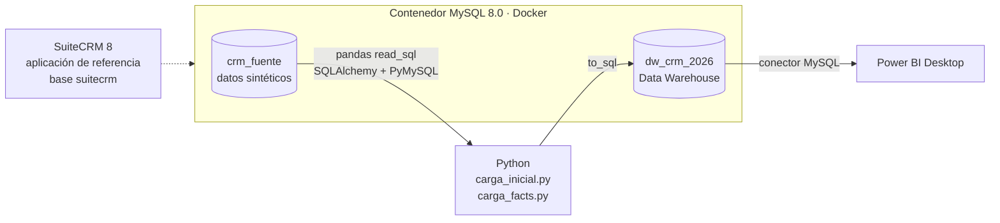

# Proyecto CRM ETL — Inteligencia Comercial y CRM

Data Warehouse dimensional (esquema estrella, metodología Kimball) para analizar el proceso comercial de un CRM: oportunidades de venta y actividades comerciales (llamadas y reuniones).
Especialización en Ingeniería de Datos — Universidad de El Salvador, 2026.

**Equipo:** Gerardo Figueroa · Roberto Ángel Aragón · Edwin Barrera

> Las secciones marcadas **[PENDIENTE]** aún no están completas y no deben leerse como implementadas.

## Contenido

1. [Contexto y alcance](#1-contexto-y-alcance)
2. [Arquitectura y componentes de nube](#2-arquitectura-y-componentes-de-nube)
3. [Modelo dimensional implementado](#3-modelo-dimensional-implementado)
4. [Reglas de negocio](#4-reglas-de-negocio)
5. [Calidad de datos (profiling de la fuente)](#5-calidad-de-datos-profiling-de-la-fuente)
6. [KPIs](#6-kpis)
7. [Cómo ejecutarlo](#7-cómo-ejecutarlo)
8. [Power BI](#8-power-bi)
9. [Estructura del repositorio](#9-estructura-del-repositorio)
10. [Problemas frecuentes](#10-problemas-frecuentes)
11. [Limitaciones conocidas](#11-limitaciones-conocidas)

## 1. Contexto y alcance

El proceso de negocio modelado es la **gestión comercial**: oportunidades de venta de cada cuenta y las actividades (llamadas y reuniones) que se realizan sobre ellas.

**Fuente de datos.** `suitecrm_dump.sql` crea una base MySQL **sintética de 7 tablas** con la estructura simplificada de las tablas comerciales de SuiteCRM (`users`, `accounts`, `leads`, `contacts`, `opportunities`, `calls`, `meetings`). No es la base real de SuiteCRM, que tiene cientos de tablas. Contiene 8 usuarios, 50 cuentas, 120 leads, 80 contactos, 150 oportunidades, 200 llamadas y 150 reuniones. No hay columna `deleted` ni tablas puente: `calls` y `meetings` traen directamente `assigned_user_id` y `opportunity_id`.

Esta base se carga en una base propia llamada **`crm_fuente`**. La aplicación SuiteCRM del `docker-compose.yml` usa su propia base (`suitecrm`) y **el ETL no la utiliza**.

## 2. Arquitectura y componentes de nube



| Capa | Tecnología | Estado |
|---|---|---|
| Origen (OLTP simulado) | MySQL 8.0 en Docker, base `crm_fuente` | Implementado |
| Sistema CRM de referencia | SuiteCRM 8 en Docker (`bitnamilegacy/suitecrm`), base `suitecrm` | Levantado; no alimenta el ETL |
| Extracción y transformación | Python 3, pandas, SQLAlchemy, PyMySQL | Implementado |
| Data Warehouse | MySQL 8.0, base `dw_crm_2026` | Implementado |
| Cliente SQL | DBeaver | En uso |
| Análisis y visualización | Power BI Desktop (Windows) | Conexión validada; tablero **[PENDIENTE]** |
| Control de versiones | Git / GitHub | En uso |

### Componentes de nube

La solución corre **íntegramente en local** (Docker Desktop, Python y Power BI Desktop). El único componente en la nube es **GitHub**, que aloja este repositorio. No se usan servicios de cómputo, almacenamiento ni bases de datos en la nube.

## 3. Modelo dimensional implementado

### 3.1 Granularidad

| Tabla de hechos | Una fila representa | Tipo |
|---|---|---|
| `fact_opportunities` | Una oportunidad de venta | Transaction fact |
| `fact_actividades` | Una actividad comercial (una llamada o una reunión) | Transaction fact |

### 3.2 Diagrama

```mermaid
erDiagram
    dim_vendedor ||--o{ fact_opportunities : "responsable"
    dim_cuenta ||--o{ fact_opportunities : "cliente"
    dim_sales_stage ||--o{ fact_opportunities : "etapa"
    dim_tiempo ||--o{ fact_opportunities : "fecha_creacion_sk"
    dim_tiempo ||--o{ fact_opportunities : "fecha_cierre_sk"
    dim_vendedor ||--o{ fact_actividades : "ejecutor"
    dim_tipo_actividad ||--o{ fact_actividades : "tipo"
    dim_tiempo ||--o{ fact_actividades : "fecha_actividad_sk"
    fact_opportunities ||--o{ fact_actividades : "oportunidad_dd (clave degenerada)"

    fact_opportunities {
        int vendedor_sk FK
        int cuenta_sk FK
        int sales_stage_sk FK
        int fecha_creacion_sk FK
        int fecha_cierre_sk FK
        varchar oportunidad_dd UK
        varchar fuente
        decimal monto
        decimal probabilidad
        int ciclo_venta_dias
        boolean ganada
    }
    fact_actividades {
        int vendedor_sk FK
        int tipo_actividad_sk FK
        int fecha_actividad_sk FK
        varchar actividad_dd UK
        varchar oportunidad_dd
        varchar estado
        decimal duracion_horas
        int contador_actividad
    }
```



`dim_lead` y `dim_contacto` se cargan pero **ninguna fact table las referencia**: la fuente no relaciona llamadas ni reuniones con contactos o leads, ni leads con oportunidades. Quedan disponibles para análisis directo (por ejemplo, conversión de leads por fuente).

### 3.3 Matriz de bus

| Hecho | vendedor | tiempo | cuenta | sales_stage | tipo_actividad |
|---|:-:|:-:|:-:|:-:|:-:|
| `fact_opportunities` | ✓ (responsable) | ✓ (×2: creación y cierre) | ✓ | ✓ | |
| `fact_actividades` | ✓ (ejecutor) | ✓ | | | ✓ |

### 3.4 Tipos de dimensiones implementadas

| Dimensión | Tipo | Detalle |
|---|---|---|
| `dim_tiempo` | Calendario, **conformada**, **role-playing** | Un día por fila, 2023-01-01 a 2027-12-31 (1,826 filas). Clave `tiempo_sk` con formato `YYYYMMDD`, excepción admitida por Kimball para la dimensión de fecha. Se usa dos veces en `fact_opportunities` (creación y cierre) |
| `dim_vendedor` | **Conformada** | Compartida por ambas facts, con rol distinto: responsable de la oportunidad vs. ejecutor de la actividad |
| `dim_cuenta` | Descriptiva estándar | Origen: `accounts` |
| `dim_lead`, `dim_contacto` | Descriptivas sin hecho asociado | Ver 3.2 |
| `dim_sales_stage` | Catálogo / referencia | 10 etapas con `orden_pipeline`, `es_cerrada`, `es_ganada`. Definida en el ETL |
| `dim_tipo_actividad` | Catálogo / referencia | Call, Meeting. Definida en el ETL |
| `oportunidad_dd`, `actividad_dd` | **Dimensiones degeneradas** | UUID del origen guardado en la fact table, sin tabla propia, para trazabilidad. `oportunidad_dd` en `fact_actividades` enlaza ambas facts |

**Llaves.** Las surrogate keys son enteros autoincrementales generados por el DW. La llave natural del CRM (UUID) se conserva en columnas `*_nk` con restricción `UNIQUE`.

**Historial (SCD).** No se implementa. Cada ejecución del ETL recarga las dimensiones completas (equivale a SCD Tipo 1). La estructura con surrogate keys deja preparado un SCD Tipo 2.

**Decisión de diseño debatible.** `fuente` y `estado` son atributos descriptivos de baja cardinalidad que viven en la fact table. La alternativa más estricta en Kimball es una dimensión pequeña por cada uno; se mantuvieron en la fact para no agregar tablas sin valor analítico adicional.

## 4. Reglas de negocio

| Código | Regla | Dónde se aplica |
|---|---|---|
| RN-01 | Una oportunidad **ganada** es la de `sales_stage = 'Closed Won'` | `carga_facts.py` → `ganada` |
| RN-02 | Una oportunidad **cerrada** es `Closed Won` o `Closed Lost` | `dim_sales_stage.es_cerrada` |
| RN-03 | El **ciclo de venta** se calcula solo para oportunidades cerradas y nunca es negativo. En las abiertas, `close_date` es una fecha estimada y el ciclo queda en `NULL` | `carga_facts.py` → `ciclo_venta_dias` |
| RN-04 | El **forecast** es `monto × probabilidad / 100`. Se calcula en la consulta o medida, no se almacena | Consultas / Power BI |
| RN-05 | Un lead **convertido** es el que tiene `converted = 1` (no se usa el texto de `status`, ver sección 5) | `dim_lead.convertido` |
| RN-06 | Las **actividades** son llamadas y reuniones, sin importar su estado, y cada una pertenece a una oportunidad | `fact_actividades` |
| RN-07 | El `vendedor` de `fact_actividades` es quien ejecuta la actividad. Puede ser distinto del responsable de la oportunidad (ocurre en 298 de 350 actividades) | `fact_actividades.vendedor_sk` |
| RN-08 | Un monto o probabilidad nulos se cargan como 0 | `carga_facts.py` |
| RN-09 | Las filas de hechos con llave de dimensión sin correspondencia se **descartan y se reportan** en consola | `carga_facts.py` |
| RN-10 | La carga es **completa y repetible**: primero se extrae y transforma todo en memoria; solo después se vacían las tablas del DW y se insertan los datos. Si la fuente falla, el DW no se modifica | `carga_inicial.py`, `carga_facts.py` |

## 5. Calidad de datos (profiling de la fuente)

| Hallazgo | Resultado |
|---|---|
| Nulos | 0 en todas las columnas de las 7 tablas |
| Duplicados por llave | 0 |
| Llaves huérfanas | 0 (oportunidades→cuenta y vendedor; llamadas y reuniones→oportunidad y vendedor) |
| Fechas | Oportunidades creadas entre 2025-05-29 y 2026-05-23; cierre entre 2025-06-23 y 2026-09-10; `close_date < date_entered`: 0 casos |
| Inconsistencia | **18 leads** con `status = 'Converted'` y `converted = 0`. Con `converted = 1` (RN-05) la conversión es 53/120 = 44.2 %; con `status` sería 71/120 = 59.2 % |
| Probabilidad | Coincide con la estándar de la etapa en el 100 % de las oportunidades |
| Atributos constantes | `users.title`, `users.department` y `accounts.billing_country` tienen un solo valor |
| Texto | Algunos nombres de usuario tienen errores en la fuente (por ejemplo "Jos") y se cargan tal cual |

## 6. KPIs

Las consultas de referencia están en [`consultas_kpi.sql`](consultas_kpi.sql).

| KPI | Fórmula | Aditividad | Resultado actual |
|---|---|---|---|
| Win Rate por vendedor | ganadas ÷ **base declarada** (cerradas o total) | Ratio: no se suma, se recalcula | 58.1 % sobre cerradas (18/31) · 12.0 % sobre el total (18/150) |
| Lead-to-Opportunity rate | leads convertidos ÷ total de leads (`dim_lead`) | Ratio | 44.2 % (53/120) |
| Ciclo de venta promedio | `AVG(ciclo_venta_dias)`, solo cerradas | No aditiva: se promedia | 53.0 días (31 cerradas) |
| Forecast vs real | `SUM(monto × probabilidad/100)` de abiertas vs `SUM(monto)` de ganadas | Aditiva (monto) | 5,928,620 vs 2,036,823 |
| Actividades por oportunidad | actividades ÷ oportunidades, unidas por `oportunidad_dd` | El conteo es aditivo; el ratio no | 2.33 (350/150) |

> **Win rate por vendedor:** las oportunidades cerradas por vendedor son pocas (entre 2 y 6), así que un 100 % se apoya en muy pocos casos. Mostrar siempre la base.
>
> **Forecast vs real:** en las oportunidades ganadas la probabilidad es 100, por lo que forecast = real. La comparación informativa es *pipeline abierto ponderado* frente a *ingresos ganados*.
>
> **Riesgo de doble conteo:** no unir las dos fact tables solo por `vendedor_sk`. Cada fila de una se multiplica por todas las de la otra (con ese enfoque un vendedor llegaba a 1,081 actividades cuando el total real es 350). Para combinarlas, unir por `oportunidad_dd`.

## 7. Cómo ejecutarlo

**Requisitos:** Docker Desktop, Python 3.10+ y Git.

### 7.1 Levantar los contenedores

```bash
docker compose up -d
docker ps                  # deben aparecer suitecrm-mysql y suitecrm
```

La primera vez, SuiteCRM tarda varios minutos en instalarse (`docker logs -f suitecrm`). Su interfaz queda en http://localhost:8080.

### 7.2 Crear la base fuente y el Data Warehouse

Los comandos usan `docker cp` y `docker exec`, así funcionan igual en PowerShell, CMD, macOS y Linux (la redirección `<` de PowerShell no sirve con `docker exec`).

```bash
# Base fuente (datos sintéticos)  ->  NO usar la base "suitecrm"
docker exec suitecrm-mysql mysql -uroot -proot123 -e "CREATE DATABASE IF NOT EXISTS crm_fuente CHARACTER SET utf8mb4;"
docker cp suitecrm_dump.sql suitecrm-mysql:/tmp/suitecrm_dump.sql
docker exec suitecrm-mysql sh -c "mysql -uroot -proot123 --default-character-set=utf8mb4 crm_fuente < /tmp/suitecrm_dump.sql"

# Data Warehouse: estructura y dimensión de tiempo (una sola vez)
docker cp CreacionDW.sql suitecrm-mysql:/tmp/CreacionDW.sql
docker exec suitecrm-mysql sh -c "mysql -uroot -proot123 --default-character-set=utf8mb4 < /tmp/CreacionDW.sql"
docker cp LlenarDimTiempo.sql suitecrm-mysql:/tmp/LlenarDimTiempo.sql
docker exec suitecrm-mysql sh -c "mysql -uroot -proot123 --default-character-set=utf8mb4 < /tmp/LlenarDimTiempo.sql"
```

También puede ejecutarse cada `.sql` desde DBeaver (conexión a `localhost:3306`, usuario `root`) con *Ejecutar script* (Alt+X). `LlenarDimTiempo.sql` debe correr una sola vez: repetirlo da error de llave duplicada.

Para rehacer el DW desde cero: `docker exec suitecrm-mysql mysql -uroot -proot123 -e "DROP DATABASE dw_crm_2026;"` y repetir `CreacionDW.sql` y `LlenarDimTiempo.sql`.

### 7.3 Ejecutar el ETL

```bash
python -m venv venv
venv\Scripts\activate          # Windows (en macOS/Linux: source venv/bin/activate)
pip install -r requirements.txt

python carga_inicial.py        # dimensiones (vacía y recarga; también vacía los hechos)
python carga_facts.py          # hechos
```

Es **repetible**: puede ejecutarse varias veces y deja siempre el mismo resultado. Siempre en este orden (dimensiones y después hechos).

**Resultado esperado:** `dim_vendedor` 8 · `dim_cuenta` 50 · `dim_lead` 120 · `dim_contacto` 80 · `dim_sales_stage` 10 · `dim_tipo_actividad` 2 · `dim_tiempo` 1,826 · `fact_opportunities` 150 · `fact_actividades` 350.

### 7.4 Validar

Ejecutar [`consultas_kpi.sql`](consultas_kpi.sql) en DBeaver. Las tres primeras consultas (V1–V3) validan conteos e integridad; el resto calcula los KPIs.

### 7.5 Configuración de conexiones

Los valores por defecto (en `config.py`) corresponden al `docker-compose.yml` local. Para otro entorno, definir variables de entorno sin tocar el código: `DB_HOST`, `DB_PORT`, `DB_USER`, `DB_PASSWORD`, `DB_ORIGEN` (por defecto `crm_fuente`) y `DB_DW` (por defecto `dw_crm_2026`).

> Las credenciales por defecto (`root` / `root123`) son del contenedor local de desarrollo y no deben usarse fuera de este entorno.

## 8. Power BI

Power BI Desktop solo está disponible para **Windows**.

1. Instalar **MySQL Connector/NET** (Oracle, descarga en dev.mysql.com). Sin él, Power BI no puede conectarse a MySQL.
2. *Obtener datos → Base de datos MySQL*. Servidor `localhost:3306`, base de datos **`dw_crm_2026`**.
3. Cargar las 9 tablas del DW. Conectar **siempre al DW**, no a `crm_fuente`.
4. `dim_tiempo` tiene dos relaciones con `fact_opportunities` (fecha de creación y de cierre): solo una puede estar activa y la otra se usa en las medidas con `USERELATIONSHIP` de DAX.
5. Power BI antepone el nombre de la base a cada tabla al cargarla (por ejemplo `dw_crm_2026 fact_opportunities`). **Renombrar las tablas** quitando ese prefijo (`fact_opportunities`, `dim_vendedor`...); de lo contrario las fórmulas DAX fallan con "Failed to resolve name".

**Tablero: [PENDIENTE].** Preguntas de negocio que debe responder cada visual:

1. ¿Cuánto vale el pipeline abierto ponderado y cuánto se ha ganado? (tarjetas)
2. ¿Qué vendedores ganan más y cuáles tienen más pipeline? (barras por vendedor, mostrando la base del win rate)
3. ¿Cómo se distribuye el pipeline por etapa? (embudo)
4. ¿Qué industrias y qué fuentes de prospecto generan más oportunidades y más ganadas?
5. ¿Cuánto esfuerzo comercial recibe cada oportunidad? (actividades por oportunidad)
6. ¿Cómo evoluciona la creación y el cierre de oportunidades en el tiempo?

Los valores de `consultas_kpi.sql` sirven para comprobar que las medidas del tablero dan el mismo resultado. **[PENDIENTE: agregar capturas o el archivo .pbix.]**

## 9. Estructura del repositorio

```
proyecto-crm-etl/
├── docker-compose.yml     # MySQL 8.0 + SuiteCRM 8
├── suitecrm_dump.sql      # Datos sintéticos de origen (se cargan en crm_fuente)
├── CreacionDW.sql         # DDL del modelo dimensional
├── LlenarDimTiempo.sql    # Procedimiento que genera dim_tiempo (2023-2027)
├── config.py              # Conexiones (variables de entorno DB_*)
├── carga_inicial.py       # ETL de las 6 dimensiones
├── carga_facts.py         # ETL de fact_opportunities y fact_actividades
├── consultas_kpi.sql      # Validaciones y KPIs
├── requirements.txt
├── .gitignore
└── README.md
```

## 10. Problemas frecuentes

| Síntoma | Causa | Solución |
|---|---|---|
| SuiteCRM muestra "500 Internal Server Error" tras cargar datos | El dump se cargó en la base `suitecrm` y reemplazó tablas propias de SuiteCRM (`users`, `accounts`, `leads`...) | Cargar el dump solo en `crm_fuente`. Para recuperar SuiteCRM: `docker compose down -v` y volver a levantar (borra las bases; el DW se regenera con los pasos 7.2 y 7.3) |
| `Unknown database 'crm_fuente'` al ejecutar el ETL | No se creó o cargó la base fuente | Repetir el paso 7.2 |
| `✗ No hay oportunidades válidas para cargar` | Se ejecutó `carga_facts.py` antes que `carga_inicial.py` | Ejecutar primero `carga_inicial.py`. Los hechos existentes no se modifican |
| Power BI no ofrece el conector MySQL o falla al conectar | Falta MySQL Connector/NET | Instalarlo (paso 8.1) y reiniciar Power BI |
| `docker exec` falla con "No such container" | El nombre del contenedor es `suitecrm-mysql` | Verificar con `docker ps` |

## 11. Limitaciones conocidas

- La fuente es sintética y limpia; el profiling no reproduce los problemas de calidad de un CRM real.
- No hay carga incremental ni historial de cambios (SCD). La tabla `parametros` queda reservada para una carga incremental futura y hoy no se usa.
- `dim_lead` y `dim_contacto` no están conectadas a ninguna tabla de hechos (ver 3.2). Una tabla `fact_leads` permitiría analizar la conversión por vendedor y por mes.
- SuiteCRM está levantado como sistema de referencia, pero los datos del ETL vienen de la base sintética `crm_fuente`.
